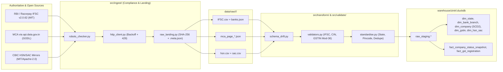

# Zintrl Data Engineering Take-Home: Public API Discovery, Sourcing & Warehouse Pipeline

**Author:** Parth Singh  
**Date:** `2026-11-18`  
**Posture:** Compliance-first. Every dataset ingested in this repository is public, free, `robots.txt`-checked, and entity-level (zero personal data on private individuals, zero captcha/OTP bypassing).

---

## 1. Executive Summary & Chosen APIs

After inventorying **612** API/product pages across **Surepass.io** (`surepass.io/page-sitemap.xml`) and **Perfios** (`perfios.ai/page-sitemap.xml`) in [`CATALOG_INVENTORY.csv`](file:///Users/parthsingh/Documents/data-mine/CATALOG_INVENTORY.csv), **536** endpoints were eliminated (`316` proprietary/SaaS, `141` personal data, `79` consent-gated), leaving **76** `entity-level public data` candidates.

From those survivors, we selected **3 complementary entity-level APIs** from the Surepass/Perfios catalogs, traced each to its authoritative upstream, and ingested real entity data (plus a supplemental GSTIN validator/gap analysis):

| # | Chosen Vendor API | Authoritative Upstream | Legitimate Sourcing Path Used | Live Rows Loaded |
|---|---|---|---|---|
| 1 | **IFSC Code Verification API** (`surepass.io/ifsc-code-verification-api/`) | Reserve Bank of India (RBI) | `razorpay/ifsc` GitHub Release `v2.0.62` (MIT mirror of RBI directory) | **183,214** branches |
| 2 | **MCA Data API / KYB** (`surepass.io` / `perfios.ai/in/products/kyc-kyb/`) | Ministry of Corporate Affairs (MCA) | `api.data.gov.in` Resource `4dbe5667-...` (GODL; 3.74M total) | **2,000** companies |
| 3 | **LEI Validation API** (`surepass.io/lei-validation-api/`) | **GLEIF** (Global LEI Foundation) | Official `api.gleif.org` REST API (CC0; 411,277 IN entities) | **200** Indian entities |
| *Supp.* | **GST Verification API** (`surepass.io/gst-verification-api/`) | GSTN / CBIC | Live portal captcha-gated -> GSP required in prod; CBIC HSN/SAC + Mod-36 GSTIN validator built | **649** HSN/SAC + **4** fixtures |

> **Why open upstreams instead of paying Surepass/Perfios?** Zintrl aggregates public data. Calling a commercial KYB wrapper at per-call pricing for data that is already published under **GODL**, **CC0**, or **MIT** adds middleman cost without exclusivity. We used the vendor catalogs as our **schema & demand benchmark**, then traced each API to its primary public source — reserving commercial/GSP APIs strictly for access-gated registries (like live GSTIN taxpayer status).

### Selection Scoring Matrix (1–5 scale)
| Candidate Domain | Public Upstream Exists | Bulk / Open API Access | Legal / License Clarity | Data Richness | Cross-Source Joinability | Total | Verdict |
|---|---|---|---|---|---|---|---|
| **IFSC / Bank Branch** | 5 | 5 (MIT GitHub + REST) | 5 (MIT / RBI) | 4 | 5 (`pincode`, `state`) | **24/25** | **Selected** |
| **MCA Company Master** | 5 | 4 (`data.gov.in` API) | 5 (GODL) | 5 | 5 (`CIN`, `pincode`, `state`) | **24/25** | **Selected** |
| **GLEIF LEI (India)** | 5 | 5 (`api.gleif.org`, no auth) | 5 (CC0 Public Domain) | 5 | 5 (`CIN`, `GSTIN`, `pincode`) | **25/25** | **Selected** |
| **GSTIN Taxpayer Lookup** | 5 | 1 (captcha / GSP-gated) | 4 (GSTN / GSP) | 5 | 5 (`PAN`, `state_code`) | **20/25** | **GSP-gated (Supplemental)** |
| **Udyam / MSME** | 4 | 1 (OTP/captcha-gated) | 3 | 3 | 3 | **14/25** | Rejected (access barrier) |

---

## 2. Pipeline Architecture

---

## 3. Per-API End-to-End Breakdown

### 3.1 IFSC / Bank Branch Master (`surepass.io/ifsc-code-verification-api/`)
- **Discovery & Mirror vs. Authority:** Retrieved Surepass's live IFSC endpoint page (input: 11-char IFSC; output: bank, branch, address, MICR, NEFT/RTGS/IMPS/UPI; auth: Bearer key via free sandbox). Traced upstream to **RBI's NEFT/RTGS directory**. Note that `razorpay/ifsc` (`v2.0.62`, MIT) is a **third-party mirror**, not the regulator itself; we use it in the prototype for clean CSV/JSON parsing, while in production Zintrl should ingest RBI's primary workbooks directly (or cross-verify deltas against `rbi.org.in`) to avoid single-vendor mirror dependency.
- **Ingestion:** [`src/ingest/ifsc_ingest.py`](file:///Users/parthsingh/Documents/data-mine/src/ingest/ifsc_ingest.py) downloads `IFSC.csv` (`36.37 MB`) and `banks.json` (`299 KB`) into `data/raw/rbi_ifsc/2026-11-18/` with SHA-256 sidecar `.meta.json`.
- **Cleaning:** [`transform_ifsc`](file:///Users/parthsingh/Documents/data-mine/src/transform/standardise.py) validates `^[A-Z]{4}0[A-Z0-9]{6}$`, fills missing `BANK` names using `banks.json` via `IFSC[:4]` (reducing null bank names to `0.56%`), strips `.0` from `MICR`, extracts 6-digit `pincode`, and maps `STATE`/`ISO3166` to canonical `dim_state`.
- **Warehouse Model:** `warehouse.dim_bank_branch` (`ifsc` PK) with payment-rail booleans (`neft`, `rtgs`, `imps`, `upi`) and lineage columns (`source`, `ingested_at`, `source_version`).

### 3.2 MCA Company Master Data (`surepass.io` / `perfios.ai/in/products/kyc-kyb/`)
- **Discovery & Access:** Retrieved Perfios's live `kyc-kyb` suite page (enterprise OAuth2/API Key via `hub.perfios.com`). `www.mca.gov.in/robots.txt` returned `403` (WAF) and `www.data.gov.in/robots.txt` returned `Disallow: /`, whereas `api.data.gov.in/robots.txt` returned `404` (open API). We use official `api.data.gov.in` resource `4dbe5667-7b6b-41d7-82af-211562424d9a` (`3,738,721` total records, GODL license). Rejected `matcdac/CorporateIndiaDataSourceXLSX` (unlicensed, 2015–2016 stale).
- **Ingestion:** [`src/ingest/mca_ingest.py`](file:///Users/parthsingh/Documents/data-mine/src/ingest/mca_ingest.py) paginates `api.data.gov.in` with `1.5s` per-host delay and exponential backoff using `DATA_GOV_IN_API_KEY`.
- **Cleaning:** [`parse_cin`](file:///Users/parthsingh/Documents/data-mine/src/validate/validators.py) decomposes 21-char CINs into `listing_status`, 5-digit `industry_code` (recovering NIC codes where raw `nic_code` is `"NA"`), `cin_state_code`, `incorporation_year`, `ownership_type`, and `registration_number`.
- **Warehouse Model:** `warehouse.dim_company` implements **idempotent SCD Type 2** via `record_hash` (`MD5(company_status | registered_address | paidup_capital)`), plus `warehouse.fact_company_status_snapshot`.

### 3.3 Legal Entity Identifier (`surepass.io/lei-validation-api/` -> Official GLEIF)
- **Discovery & Access:** Retrieved Surepass's live `LEI Validation API` page (`surepass.io/lei-validation-api/`). Traced directly to **GLEIF** (`https://api.gleif.org/api/v1/lei-records?filter[entity.legalAddress.country]=IN`), which is **CC0 1.0 Public Domain**, requires **no auth**, and returned `robots.txt` `Disallow:` (empty) with **`411,277`** Indian corporate entities.
- **Ingestion:** [`src/ingest/gleif_ingest.py`](file:///Users/parthsingh/Documents/data-mine/src/ingest/gleif_ingest.py) lands `200` Indian LEI records into `data/raw/gleif_lei/2026-11-18/`.
- **Cleaning & Warehouse Model:** [`transform_gleif_lei`](file:///Users/parthsingh/Documents/data-mine/src/transform/standardise.py) loads `warehouse.dim_lei` (`lei` PK), extracting `registration_authority_id` (`RA000394` = MCA India) and `registered_as`, which surfaces real **MCA CINs** (`U72900UP2021PTC145415`), **public GSTINs** (`09AAPPG1336G1ZR`), and **Udyam IDs** (`UDYAM-CG-14-0015360`) that join directly to `dim_bank_branch` and `dim_company`.

### 3.4 Supplemental: GSTIN Production Route & Gap Analysis (`surepass.io/gst-verification-api/`)
- **Why live GSTIN is not scraped:** `services.gst.gov.in/services/searchtp` is **captcha-gated** (`verified`). In production, Zintrl must either license a **GSP (GST Suvidha Provider)** API or call Surepass/Perfios with a commercial key. For the prototype, we built the deterministic **15-char GSTIN mod-36 checksum validator** (`src/validate/validators.py`) + CBIC HSN/SAC reference (`dim_hsn_sac`) so the schema and validation layer are production-ready once a GSP key is provisioned.

---

## 4. Observed Pipeline & Query Results

From running `python -m warehouse.load_warehouse` and [`warehouse/sample_queries.sql`](file:///Users/parthsingh/Documents/data-mine/warehouse/sample_queries.sql) on `2026-11-18` (full outputs in [`docs/sample_query_outputs.txt`](file:///Users/parthsingh/Documents/data-mine/docs/sample_query_outputs.txt)):

| Table / Source | Raw Rows | Clean Rows | Invalid / Dupes Dropped | Observed Null Rates |
|---|---:|---:|---:|---|
| `dim_bank_branch` (`rbi_ifsc`) | 183,214 | 183,214 | 0 / 0 | `bank_name`: 0.56%, `pincode`: 38.07%, `state_name`: 0.00% |
| `dim_company` (`mca_company`) | 2,020 | 2,000 | 0 / 20 | `pincode`: 8.85%, `state_name`: 0.00% |
| `dim_lei` (`gleif_lei`) | 200 | 200 | 0 / 0 | `registered_as`: 1.00%, `pincode`: 0.00% |
| `dim_hsn_sac` (`gst_hsn_sac`) | 649 | 649 | 0 / 0 | `description`: 0.00% |
| `dim_state` | — | 36 | — | 0.00% |
| `dim_gstin` (validated fixtures) | — | 4 | — | 0.00% |

- **Cross-source join highlight (Query 1 & 2):** Across Gujarat (`gst_state_code = 24`), `2,000` MCA companies join to `12,104` RBI bank branches at state level and `5,359` branches at exact 6-digit `pincode` level (e.g., `RANJEET MECHATRONICS LIMITED`, `L31100GJ1993PLC019635`, pincode `380015` maps to `134` branches, `130` UPI-enabled).
- **Idempotency & Tests:** `pytest -v` passes **7/7** tests, including `test_warehouse_idempotency` (`scd_inserts_this_run == 0` on second run).

---

## 5. Constraints, Risks & Mitigations

| # | Constraint / Risk | Severity | Evidence | Mitigation |
|---|---|---|---|---|
| 1 | `data.gov.in` sample key caps at 10 rows/req & returns HTTP `429` | High | `mca_ingest.py` hit `429` at `offset=30` | Register free personal `DATA_GOV_IN_API_KEY`; run incremental RoC-wise syncs |
| 2 | `services.gst.gov.in/services/searchtp` is captcha-gated | High | Live GSTN portal requires captcha | Never bypass; license a **GSP** API or commercial sandbox for live GSTIN status |
| 3 | `www.data.gov.in/robots.txt` = `Disallow: /`; `www.mca.gov.in` = `403` | High | Direct HTTP checks on `2026-11-18` | Use `api.data.gov.in` (`404` on `robots.txt`) exclusively |
| 4 | 38.07% of RBI IFSC addresses lack a 6-digit pincode | Medium | Observed in `dim_bank_branch` metrics | Fallback join on `(gst_state_code, city/district)` or India Post pincode directory |
| 5 | `MCA` `nic_code` field is `"NA"` on sampled records | Medium | `MCA Record 0` (`U27900GJ2025PTC166696`) | Extract 5-digit NIC code directly from `CIN[1:6]` (`27900`) |

---

## 6. Alternative Problem Statement: Public Land Records Assessment

| State Portal | Discovery & Structure | ToS / Technical Posture | Personal Data (DPDP Act 2023) | Feasibility Verdict |
|---|---|---|---|---|
| **UP Bhulekh** (`upbhulekh.gov.in`) | District/Tehsil/Village/Khata hierarchy; no bulk open API | Captcha-gated; WAF/IP throttling on automated queries | High: landowner names, father's names, Khata/Khasra shares | **Not feasible** for legitimate bulk commercial aggregation |
| **Karnataka Bhoomi** (`landrecords.karnataka.gov.in`) | Taluk/Hobli/Village RTC lookup | Captcha/session-gated web UI; no public bulk download | High: individual cultivator/owner PII | **Not feasible** without state govt MoU |
| **Maharashtra Mahabhulekh** (`bhulekh.mahabhumi.gov.in`) | 7/12 (Satbara) & 8A extracts by district/survey no. | Login/captcha-gated for downloads; anti-bot controls | High: individual landholder PII & encumbrances | **Not feasible** for commercial scraping |
| **Rajasthan Apna Khata** (`apnakhata.rajasthan.gov.in`) | District/Tehsil/Village Jamabandi | Explicit ToS/copyright restriction against unauthorized reproduction (`verified` via search) | High: individual owner & caste/khata metadata | **Explicitly prohibited** by ToS + DPDP risk |

**Comparison Verdict:** Public state land-record portals are fragmented across 28+ state schemas, heavily captcha-gated, and expose sensitive **individual PII** under the **DPDP Act 2023**. By contrast, the **IFSC + MCA + GST/HSN** path is **entity-level**, backed by **GODL / MIT** open licenses, and joins cleanly into a commercial B2B warehouse.

---

## 7. Open Questions & Next Steps With Full Access
1. **Open Questions:** Does Zintrl have an existing **GSP** license for live GSTIN/GSTR status? Which MCA RoC states and company statuses (`Active` vs `Strike Off`) are highest priority for initial backfill?
2. **Next Steps:**
   - Provision a personal `DATA_GOV_IN_API_KEY` and schedule incremental `mca_ingest.py` runs (via Prefect/Airflow/cron) to backfill all `3.74M` MCA entities.
   - Integrate a licensed GSP or Surepass/Perfios production key for live PAN-to-GSTIN and GSTIN status enrichment.
   - Enrich `dim_bank_branch` missing pincodes using India Post's open pincode directory (`data.gov.in`) and run `dbt test` on all mart models.
