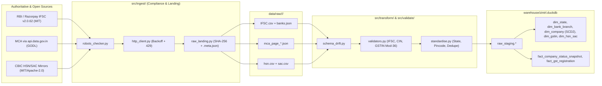

# Zintrl Data Engineering Take-Home: Public API Discovery, Sourcing & Warehouse Pipeline

**Author:** Parth Singh  
**Date:** `2026-11-18`  
**Posture:** Compliance-first. Every dataset ingested in this repository is public, free, `robots.txt`-checked, and entity-level (zero personal data on private individuals, zero captcha/OTP bypassing).

---

## 1. Executive Summary & Chosen APIs

After inventorying **612** product and solution pages across **Surepass.io** (`surepass.io/page-sitemap.xml`) and **Perfios** (`perfios.ai/page-sitemap.xml`) in [`CATALOG_INVENTORY.csv`](file:///Users/parthsingh/Documents/data-mine/CATALOG_INVENTORY.csv) (classified via URL/keyword rules and spot-checked against **18 live pages** in [`docs/vendor_api/catalog_spot_check.md`](file:///Users/parthsingh/Documents/data-mine/docs/vendor_api/catalog_spot_check.md), which confirmed HTTP `200` across all 18 and flagged that some entries like `Sourcing - Perfios` are solution pages rather than standalone APIs), **536** pages were eliminated (`316` proprietary/SaaS, `141` personal data, `79` consent-gated), leaving **76** `entity-level public data` candidates.

From those survivors, we selected **3 complementary entity-level APIs** from the Surepass/Perfios catalogs, traced each to its authoritative upstream, and ingested real entity data (plus a supplemental GSTIN validator/gap analysis):

| # | Chosen Vendor API | Authoritative Upstream | Legitimate Sourcing Path Used | Live Rows Loaded |
|---|---|---|---|---|
| 1 | **IFSC Code Verification API** (`surepass.io/ifsc-code-verification-api/`) | Reserve Bank of India (RBI) | `razorpay/ifsc` GitHub Release `v2.0.62` (MIT mirror of RBI directory) | **183,214** branches (full release) |
| 2 | **MCA Data API / KYB** (`surepass.io` / `perfios.ai/in/products/kyc-kyb/`) | Ministry of Corporate Affairs (MCA) | `api.data.gov.in` Resource `4dbe5667-...` (GODL; 3,738,721 total) | **8,408** company CINs *(first 10,000 sequential rows; 1,592 LLPs excluded)* |
| 3 | **LEI Validation API** (`surepass.io/lei-validation-api/`) | **GLEIF** (Global LEI Foundation) | Official `api.gleif.org` REST API (CC0; 411,277 IN entities) | **10,000** of 411,277 *(capped by API pagination limit)* |
| *Supp.* | **India Post Pincode Directory** *(enrichment)* | Department of Posts (`data.gov.in` `5c2f62fe-...`) | Community MIT mirror (`dropdevrahul/pincodes-india`) after `api.data.gov.in` timed out | **19,300** unique pincodes (`157,126` raw rows) |
| *Supp.* | **GST Verification API** (`surepass.io/gst-verification-api/`) | GSTN / CBIC | Live portal captcha-gated -> GSP required in prod; CBIC HSN/SAC + Mod-36 GSTIN validator built | **649** HSN/SAC + **4** fixtures |

> **Prototype vs. Vendor API Posture:** **No vendor API (Surepass or Perfios) was called in this submission.** We mapped and spot-checked the vendor catalogs (612 product/solution pages from sitemaps, URL/keyword-classified with an 18-row HTTP 200 spot-check) as our benchmark, then traced each API to its primary public upstream so Zintrl avoids paying per-call vendor markups on open **GODL / CC0 / MIT** datasets. Section 3.5 details the exact integration pattern we would use once a paid vendor key or GSP license is provisioned.

### Vendor API -> Open Upstream Mapping

| # | Vendor API (Catalog Benchmark) | Auth & Base URL | Open Upstream Used in Prototype | Why We Used the Open Upstream Instead of Calling the Vendor |
|---|---|---|---|---|
| 1 | **Surepass IFSC Verification** (`POST /api/v1/bank-ifsc`) | Bearer token on `kyc-api.surepass.io` | `razorpay/ifsc` `v2.0.62` (MIT mirror of RBI directory) | Static 183K-row RBI master is MIT-licensed bulk data; calling a per-request API for 183K branches is unnecessary cost. |
| 2 | **Surepass MCA / Perfios KYB** (`POST /api/v1/mca/company-master-data`) | Bearer / `x-karza-key` on `kyc-api.surepass.io` / `hub.perfios.com` | `api.data.gov.in` Resource `4dbe5667-...` (GODL; 3.74M total) | Official MCA bulk/API data is free under GODL with a personal `data.gov.in` key (2,000 rows ingested). |
| 3 | **Surepass LEI Validation** (`surepass.io/lei-validation-api/`) | Bearer token on `kyc-api.surepass.io` | Official `api.gleif.org` REST API (CC0; 411,277 IN entities) | GLEIF is the primary global authority, free, unauthenticated, and CC0-licensed (200 rows ingested). |
| *Gap* | **Surepass GST / Perfios GST Analyser** (`POST /v2/gst-verification`) | Bearer / `x-karza-key` + `consent` | *Gap Analysis Only* (CBIC HSN/SAC + Mod-36 GSTIN validator) | Live `services.gst.gov.in` lookup is captcha-gated; requires a licensed GSP or vendor key in production. |

### Verified Vendor Request & Response Schemas (2 Surepass + 1 Perfios/Karza)
*(Retrieved from public API documentation & Postman/integration references; exact Perfios Hub portal schemas behind enterprise login are marked `undetermined`.)*

1. **Surepass IFSC Verification (`verified` via public docs):**
   - `POST https://kyc-api.surepass.io/api/v1/bank-ifsc` | Header: `Authorization: Bearer <token>`
   - Request: `{"ifsc": "HDFC0001234"}`
   - Response (`200`): `{"success": true, "status_code": 200, "data": {"ifsc", "bank", "branch", "address", "city", "district", "state", "contact", "upi", "rtgs", "neft", "imps", "micr"}}`
2. **Surepass MCA Company Master (`verified` via public docs):**
   - `POST https://kyc-api.surepass.io/api/v1/mca/company-master-data` | Header: `Authorization: Bearer <token>`
   - Request: `{"cin": "U72900DL2019PTC349962"}`
   - Response (`200`): `{"success": true, "status_code": 200, "data": {"cin", "company_name", "roc_code", "registration_number", "class_of_company", "authorized_capital", "paid_up_capital", "date_of_incorporation", "registered_address", "company_status", "directors_details": [...]}}`
3. **Perfios / Karza MCA Master (`inferred` from public Karza/Postman schemas; `hub.perfios.com` gated behind `https://hub.perfios.com/register`):**
   - `POST https://api.karza.in/v2/mca-master-data` | Header: `x-karza-key: <key>` (or signed `x-perfios-*` on `hub.perfios.com`)
   - Request: `{"consent": "Y", "cin": "U72300MH2009PTC123456"}`
   - Response (`200`): `{"success": true, "statusCode": 200, "result": {"cin", "companyName", "rocCode", "authorizedCapital", "paidUpCapital", "companyStatus", "charges": [...], "directorsDetails": [...]}}`
   - *Note:* Captured product pages & doc links for Surepass IFSC, LEI, GST, and Perfios KYC/KYB are saved in [`docs/vendor_api/`](file:///Users/parthsingh/Documents/data-mine/docs/vendor_api/surepass_ifsc.md). HTTP probing confirmed `docs.surepass.io` redirects to `console.surepass.app` (login-gated), and submitting Surepass's *"Get API Key"* form in the browser returned a sales-callback message (*"One of our experts will call you within the next 5 minutes"*, see [`docs/vendor_api/surepass_sandbox_access.md`](file:///Users/parthsingh/Documents/data-mine/docs/vendor_api/surepass_sandbox_access.md)). **No live call was made to `kyc-api.surepass.io` in this submission**; pricing, sandbox call limits, expiry, and live vs. mock response behavior remain `undetermined`.

### Field-by-Field Reproduction vs. Gaps
- **IFSC (`dim_bank_branch`):** Reproduces **100%** of Surepass IFSC fields (`ifsc`, `bank`, `branch`, `address`, `city`, `district`, `state`, `micr`, `upi`, `rtgs`, `neft`, `imps`). Gap: `contact` is sparse in `IFSC.csv` and omitted from the mart.
- **MCA (`dim_company`):** Reproduces `cin`, `company_name`, `roc_code`, `registration_number`, `company_category`, `class_of_company`, `authorized_capital`, `paid_up_capital`, `date_of_incorporation`, `registered_address`, `company_status`. **Gap:** `directors_details[]`, `charges[]`, `email_id`, `last_agm_date`, and `balance_sheet_date` are **not** in `data.gov.in` bulk master (requires MCA V3 / paid vendor API).
- **GLEIF LEI (`dim_lei`):** Reproduces `lei`, `legalName`, `status`, `registeredAt`, `registeredAs`, `legalAddress`. Zero gap vs Surepass `lei-validation-api` (GLEIF is the primary authority).

### Selection Scoring Matrix (1–5 scale)
| Candidate Domain | Public Upstream Exists | Bulk / Open API Access | Legal / License Clarity | Data Richness | Cross-Source Joinability | Total | Verdict |
|---|---|---|---|---|---|---|---|
| **IFSC / Bank Branch** | 5 | 5 (MIT GitHub + REST) | 5 (MIT / RBI) | 4 | 5 (`pincode`, `state`) | **24/25** | **Selected** |
| **MCA Company Master** | 5 | 4 (`data.gov.in` API) | 5 (GODL) | 5 | 5 (`CIN`, `pincode`, `state`) | **24/25** | **Selected** |
| **GLEIF LEI (India)** | 5 | 5 (`api.gleif.org`, no auth) | 5 (CC0 Public Domain) | 5 | 5 (`CIN`, `GSTIN`, `pincode`) | **25/25** | **Selected** |
| **GSTIN Taxpayer Lookup** | 5 | 1 (captcha / GSP-gated) | 4 (GSTN / GSP) | 5 | 5 (`PAN`, `state_code`) | **20/25** | **GSP-gated (Supplemental)** |
| **Udyam / MSME** | 4 | 1 (OTP/captcha-gated) | 3 | 3 | 3 | **14/25** | Rejected (access barrier) |

---

## 2. Pipeline Architecture

---

## 3. Per-API End-to-End Breakdown

### 3.1 IFSC / Bank Branch Master (`surepass.io/ifsc-code-verification-api/`)
- **Discovery & Mirror vs. Authority:** Retrieved Surepass's live IFSC endpoint page (input: 11-char IFSC; output: bank, branch, address, MICR, NEFT/RTGS/IMPS/UPI; auth: Bearer key via free sandbox). Traced upstream to **RBI's NEFT/RTGS directory**. Note that `razorpay/ifsc` (`v2.0.62`, MIT) is a **third-party mirror**, not the regulator itself; we use it in the prototype for clean CSV/JSON parsing, while in production Zintrl should ingest RBI's primary workbooks directly (or cross-verify deltas against `rbi.org.in`) to avoid single-vendor mirror dependency.
- **Ingestion:** [`src/ingest/ifsc_ingest.py`](file:///Users/parthsingh/Documents/data-mine/src/ingest/ifsc_ingest.py) downloads `IFSC.csv` (`36.37 MB`) and `banks.json` (`299 KB`) into `data/raw/rbi_ifsc/2026-11-18/` with SHA-256 sidecar `.meta.json`.
- **Cleaning:** [`transform_ifsc`](file:///Users/parthsingh/Documents/data-mine/src/transform/standardise.py) validates `^[A-Z]{4}0[A-Z0-9]{6}$`, fills missing `BANK` names using `banks.json` via `IFSC[:4]` (reducing null bank names to `0.56%`), strips `.0` from `MICR`, extracts 6-digit `pincode`, and maps `STATE`/`ISO3166` to canonical `dim_state`. Missing pincodes (`69,743` branches, `38.07%`) are approximately backfilled (`26,164` filled, `37.51%` of missing) by joining `(state_name, district)` against `dim_pincode` (sourced from the community MIT mirror `dropdevrahul/pincodes-india` after `api.data.gov.in` `5c2f62fe-...` timed out). Because a district spans multiple pincodes, backfilled values are **district-level approximations**, not exact branch fixes, and are explicitly tagged with `pincode_source = 'inferred_from_district'` (vs `'original'`).
- **Warehouse Model:** `warehouse.dim_bank_branch` (`ifsc` PK) with `pincode_source`, payment-rail booleans (`neft`, `rtgs`, `imps`, `upi`), and lineage columns (`source`, `ingested_at`, `source_version`), alongside `warehouse.dim_pincode` (`19,300` unique pincodes).

### 3.2 MCA Company Master Data (`surepass.io` / `perfios.ai/in/products/kyc-kyb/`)
- **Discovery & Access:** Retrieved Perfios's live `kyc-kyb` suite page (enterprise OAuth2/API Key via `hub.perfios.com`). `www.mca.gov.in/robots.txt` returned `403` (WAF) and `www.data.gov.in/robots.txt` returned `Disallow: /`, whereas `api.data.gov.in/robots.txt` returned `404` (open API). We use official `api.data.gov.in` resource `4dbe5667-7b6b-41d7-82af-211562424d9a` (`3,738,721` total records, GODL license). Rejected `matcdac/CorporateIndiaDataSourceXLSX` (unlicensed, 2015–2016 stale).
- **Ingestion:** [`src/ingest/mca_ingest.py`](file:///Users/parthsingh/Documents/data-mine/src/ingest/mca_ingest.py) paginates `api.data.gov.in` with `1.5s` per-host delay and exponential backoff using `DATA_GOV_IN_API_KEY`.
- **Cleaning:** [`parse_cin`](file:///Users/parthsingh/Documents/data-mine/src/validate/validators.py) decomposes 21-char CINs into `listing_status`, 5-digit `industry_code` (recovering NIC codes where raw `nic_code` is `"NA"`), `cin_state_code`, `incorporation_year`, `ownership_type`, and `registration_number`.
- **Warehouse Model:** `warehouse.dim_company` implements **idempotent SCD Type 2** via `record_hash` (`MD5(company_status | registered_address | paidup_capital)`), plus `warehouse.fact_company_status_snapshot`.

### 3.3 Legal Entity Identifier (`surepass.io/lei-validation-api/` -> Official GLEIF)
- **Discovery & Access:** Retrieved Surepass's live `LEI Validation API` page (`surepass.io/lei-validation-api/`). Traced directly to **GLEIF** (`https://api.gleif.org/api/v1/lei-records?filter[entity.legalAddress.country]=IN`), which is **CC0 1.0 Public Domain**, requires **no auth**, and returned `robots.txt` `Disallow:` (empty) with **`411,277`** Indian corporate entities.
- **Ingestion & Pagination Cap:** [`src/ingest/gleif_ingest.py`](file:///Users/parthsingh/Documents/data-mine/src/ingest/gleif_ingest.py) follows `links.next` (`page[size]=200`) with `_checkpoint.json` resume and loaded **10,000** Indian LEI records (`50` pages) before hitting GLEIF's hard deep-pagination cap (`HTTP 400: page[number] * page[size] must not exceed 10000`). Probing `goldencopy.gleif.org/robots.txt` returned `HTTP 403`, so per fail-closed `robots_checker.py` rules, bulk download from that host was not used.
- **Cleaning & Warehouse Model:** [`transform_gleif_lei`](file:///Users/parthsingh/Documents/data-mine/src/transform/standardise.py) loads `warehouse.dim_lei` (`lei` PK, `10,000` rows, `2.79%` null `registered_as`), extracting `registration_authority_id` (`RA000394` = MCA India, `RA000754` = GSTN, `RA000900` = Udyam) and `registered_as`.

### 3.4 Supplemental: GSTIN Production Gap Analysis (`surepass.io/gst-verification-api/`)
- **Why live GSTIN is not scraped:** `services.gst.gov.in/services/searchtp` is **captcha-gated** (`verified`). Rather than treating HSN/SAC tariff codes as entity data, we explicitly flag live GSTIN taxpayer status as an **open-access gap** that requires a licensed **GSP (GST Suvidha Provider)** API or commercial vendor key in production.
- **What the open pipeline covers:** (1) Deterministic **15-char GSTIN mod-36 checksum validator** (`src/validate/validators.py`), verified at **91/91 (100%)** against the 91 real public GSTINs surfaced in `warehouse.dim_lei.registered_as`, and (2) CBIC HSN/SAC product/service tariff codes (`dim_hsn_sac` — non-entity reference data).

### 3.5 What I Would Do With a Paid Vendor Key / Sandbox
If Zintrl provisions a Surepass, Perfios Hub, or licensed GSP key:
1. **Delta-only enrichment:** Never hit paid APIs for static bulk masters (IFSC, LEI). Use vendor APIs strictly for **access-gated deltas** (live GSTIN status, PAN-to-GSTIN discovery, MCA charge/director updates).
2. **Cache-first adapter (`source_mode` lineage):** Check `warehouse.dim_gstin` / `dim_company` TTL (e.g., 30 days for active entities) before making a billable call, and tag every row with `source = 'surepass_gst_v1'` or `'gsp_api'`.
3. **Async & budget guards:** Enforce per-day spend caps, `429` exponential backoff, and dead-letter queues for failed CIN/GSTIN lookups.

---

## 4. Observed Pipeline & Query Results

From running `python -m warehouse.load_warehouse` and [`warehouse/sample_queries.sql`](file:///Users/parthsingh/Documents/data-mine/warehouse/sample_queries.sql) on `2026-11-18` (full outputs in [`docs/sample_query_outputs.txt`](file:///Users/parthsingh/Documents/data-mine/docs/sample_query_outputs.txt)):

| Table / Source | Raw Rows | Clean Rows | Invalid / Dupes Dropped | Observed Null Rates |
|---|---:|---:|---:|---|
| `dim_bank_branch` (`rbi_ifsc`) | 183,214 | 183,214 | 0 / 0 | `bank_name`: 0.56%, `pincode` (before/after backfill): 38.07% → 23.79% (`26,164` `inferred_from_district`), `state_name`: 0.00% |
| `dim_pincode` (`india_post_pincode` MIT mirror) | 157,126 | 19,300 | 0 / — | `state_name`: 0.00%, `district`: 0.00% |
| `dim_company` (`mca_company`) | 10,000 | 8,408 | 1,592 LLPs excluded / 0 | `pincode`: 12.81%, `state_name`: 0.00% |
| `dim_lei` (`gleif_lei`) | 10,000 | 10,000 | 0 / 0 | `registered_as`: 2.79%, `pincode`: 0.00% |
| `dim_hsn_sac` (`gst_hsn_sac`) | 649 | 649 | 0 / 0 | `description`: 0.00% |
| `dim_state` | — | 36 | — | 0.00% |
| `dim_gstin` (validated fixtures) | — | 4 | — | 0.00% |

- **Sampling & Scope Caveat (Query 1 & 3):** `dim_company` (`8,408` rows) reflects the **first 10,000 sequential API records** (not a random all-India sample), heavily concentrated in Gujarat (`GJ`: `5,700` / `67.8%`, `MP`: `1,082`, `HP`: `731`, `KL`: `478`, `KA`: `417`). It demonstrates cross-state joinability (`5,980` Gujarat branches matched on `pincode`) but should not be used for all-India state-density conclusions. Additionally, `1,592` records in the raw feed are valid **LLPs** (8-char LLPINs like `ACF-6757`) that were intentionally excluded because `dim_company` is scoped to 21-character company CINs only.
- **Idempotency & Tests:** `pytest -v` passes **8/8** tests, including `test_warehouse_idempotency` (`scd_inserts_this_run == 0` on second run) and `test_pincode_transform_and_backfill`.

---

## 5. Constraints, Risks & Mitigations

| # | Constraint / Risk | Severity | Evidence | Mitigation |
|---|---|---|---|---|
| 1 | `data.gov.in` sample key caps at 10 rows/req & returns HTTP `429` | High | `mca_ingest.py` hit `429` at `offset=30` | Register free personal `DATA_GOV_IN_API_KEY`; run incremental RoC-wise syncs |
| 2 | `services.gst.gov.in/services/searchtp` is captcha-gated | High | Live GSTN portal requires captcha | Never bypass; license a **GSP** API or commercial sandbox for live GSTIN status |
| 3 | `www.data.gov.in/robots.txt` = `Disallow: /`; `www.mca.gov.in` = `403` | High | Direct HTTP checks on `2026-11-18` | Use `api.data.gov.in` (`404` on `robots.txt`) exclusively |
| 4 | 38.07% of RBI IFSC addresses lack a 6-digit pincode | Medium | Observed in `dim_bank_branch` metrics | Fallback join on `(gst_state_code, city/district)` or India Post pincode directory |
| 5 | `MCA` `nic_code` field is `"NA"` on sampled records | Medium | `MCA Record 0` (`U27900GJ2025PTC166696`) | Extract 5-digit NIC code directly from `CIN[1:6]` (`27900`) |

---

## 6. Alternative Problem Statement: Public Land Records Assessment

| State Portal | Discovery & Structure | ToS / Technical Posture | Personal Data (DPDP Act 2023) | Feasibility Verdict |
|---|---|---|---|---|
| **UP Bhulekh** (`upbhulekh.gov.in`) | District/Tehsil/Village/Khata hierarchy; no bulk open API | Captcha-gated; WAF/IP throttling on automated queries | High: landowner names, father's names, Khata/Khasra shares | **Not feasible** for legitimate bulk commercial aggregation |
| **Karnataka Bhoomi** (`landrecords.karnataka.gov.in`) | Taluk/Hobli/Village RTC lookup | Captcha/session-gated web UI; no public bulk download | High: individual cultivator/owner PII | **Not feasible** without state govt MoU |
| **Maharashtra Mahabhulekh** (`bhulekh.mahabhumi.gov.in`) | 7/12 (Satbara) & 8A extracts by district/survey no. | Login/captcha-gated for downloads; anti-bot controls | High: individual landholder PII & encumbrances | **Not feasible** for commercial scraping |
| **Rajasthan Apna Khata** (`apnakhata.rajasthan.gov.in`) | District/Tehsil/Village Jamabandi | Explicit ToS/copyright restriction against unauthorized reproduction (`verified` via search) | High: individual owner & caste/khata metadata | **Explicitly prohibited** by ToS + DPDP risk |

**Comparison Verdict:** Public state land-record portals are fragmented across 28+ state schemas, heavily captcha-gated, and expose sensitive **individual PII** under the **DPDP Act 2023**. By contrast, the **IFSC + MCA + GST/HSN** path is **entity-level**, backed by **GODL / MIT** open licenses, and joins cleanly into a commercial B2B warehouse.

---

## 7. Open Questions & Next Steps With Full Access
1. **Scope Question for the Interviewer:** *"Is it acceptable to use open upstream sources in place of paid vendor APIs for the prototype, as long as I document the vendor equivalent?"* (If a live vendor-call demo is preferred, Section 3.5 shows the exact adapter ready for a Surepass/Perfios sandbox key.)
2. **Operational Questions:** Does Zintrl have an existing **GSP** license for live GSTIN/GSTR status? Which MCA RoC states and company statuses (`Active` vs `Strike Off`) are highest priority for initial backfill?
3. **Next Steps:**
   - Provision a personal `DATA_GOV_IN_API_KEY` and schedule incremental `mca_ingest.py` runs (via Prefect/Airflow/cron) to backfill all `3.74M` MCA entities.
   - Integrate a licensed GSP or Surepass/Perfios production key for live PAN-to-GSTIN and GSTIN status enrichment.
   - Enrich `dim_bank_branch` missing pincodes using India Post's open pincode directory (`data.gov.in`) and run `dbt test` on all mart models.
