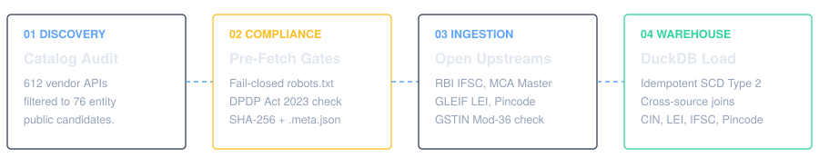
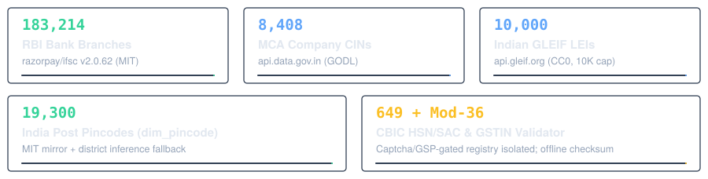

<div align="center">
  
</div>

Compliance-first, end-to-end data sourcing and warehousing pipeline built on **public, free, and legitimately accessible** Indian entity-level datasets.

## Pipeline architecture

<div align="center">
  
</div>

## Verified data sources

<div align="center">
  
</div>

<details>
<summary><b>Source registry, licenses &amp; record counts</b></summary>

<br/>

1. **RBI IFSC / Bank Branch Master** (`razorpay/ifsc` `v2.0.62`, MIT License — **183,214** branches)
2. **MCA Company Master Data** (`api.data.gov.in` Resource `4dbe5667-7b6b-41d7-82af-211562424d9a`, GODL License — **8,408** CINs)
3. **GLEIF LEI** (`api.gleif.org`, CC0 — **10,000** Indian LEIs)
4. **India Post Pincode Master** (MIT mirror — **19,300** unique pincodes)
5. **GST HSN/SAC Master &amp; GSTIN Mod-36 Validator** (CBIC MIT/Apache-2.0 mirrors + structural/checksum parser)

</details>

<details>
<summary><b>Deliverables &amp; audit artifacts</b></summary>

<br/>

- [APPROACH.md](APPROACH.md) — Final submission report, architecture diagram, metrics, risks, and land-records comparison
- [SOURCE_DECISION_LOG.md](SOURCE_DECISION_LOG.md) — Detailed discovery, upstream tracing, `robots.txt` and license audits, and mode decisions
- [CATALOG_INVENTORY.csv](CATALOG_INVENTORY.csv) — 612 Surepass.io and Perfios APIs classified and filtered to entity-level public data
- [docs/sample_query_outputs.txt](docs/sample_query_outputs.txt) — Captured cross-source DuckDB SQL query outputs
- [docs/pipeline_overview.png](docs/pipeline_overview.png) — Detailed architecture and results diagram

</details>

## Quickstart

```bash
# 1. Create virtual environment and install dependencies
python3 -m venv .venv
.venv/bin/pip install -e . pytest

# 2. Run live ingestion (respects robots.txt, rate limits, and writes SHA-256 .meta.json)
.venv/bin/python -m src.ingest.ifsc_ingest
export DATA_GOV_IN_API_KEY="your_free_datagovin_key"  # optional; defaults to public sample key
.venv/bin/python -m src.ingest.mca_ingest
.venv/bin/python -m src.ingest.gst_ingest

# 3. Clean, validate, and load DuckDB warehouse (idempotent SCD Type 2)
.venv/bin/python -m warehouse.load_warehouse

# 4. Run unit & warehouse idempotency tests
.venv/bin/pytest -v
```
